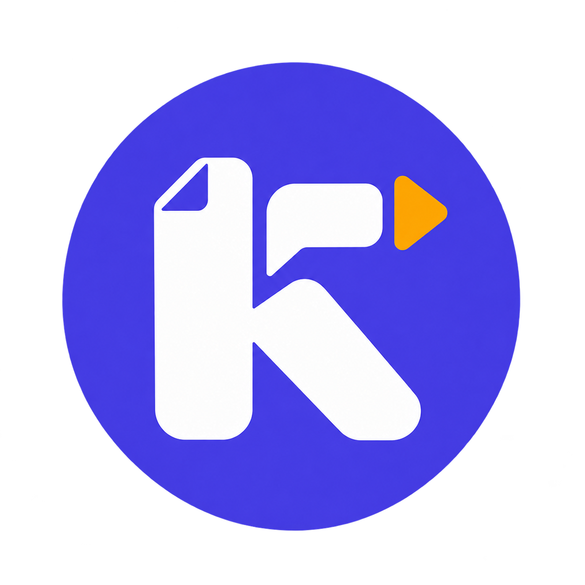
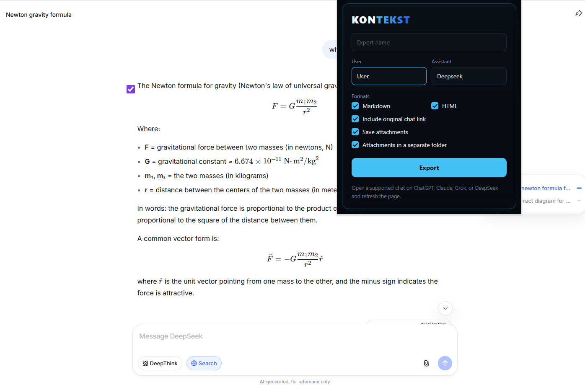
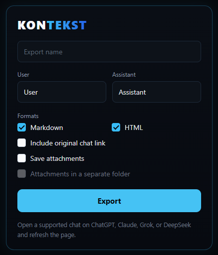

<p align="center">
  
</p>

# Kontext

**Keep the thread. Keep learning.**

Kontext is a free, open-source browser extension that turns your AI study sessions into portable Markdown and HTML archives — with optional copies of the files and images you shared — so you can continue learning on another platform when a free limit runs out.

Built for students, self-taught developers, researchers, and anyone who has ever been three hours into a problem when the message appeared:

> “You’ve reached your limit. Try again in 4 hours.”

**Version 0.1.0 · Manifest V3 · Chromium (Chrome, Edge, Brave) · Local-only**

**Open-source foundation:** Kontext’s provider-specific attachment extraction is adapted from the open-source [AI Chat Export](https://github.com/alexey-sirotin/ai-chat-export) project by Alexey Sirotin. The MIT notice is preserved in [THIRD_PARTY_NOTICES.md](THIRD_PARTY_NOTICES.md).

---

## Contents

- [Why Kontext exists](#why-kontext-exists)
- [What Kontext does](#what-kontext-does)
- [See it in action](#see-it-in-action)
- [Supported platforms](#supported-platforms)
- [Requirements](#requirements)
- [Installation](#installation)
- [Quick start](#quick-start)
- [Export options explained](#export-options-explained)
- [What is inside the ZIP](#what-is-inside-the-zip)
- [Continuing on another AI platform](#continuing-on-another-ai-platform)
- [Your study archive](#your-study-archive)
- [Privacy and permissions](#privacy-and-permissions)
- [Troubleshooting](#troubleshooting)
- [FAQ](#faq)
- [Current limitations and roadmap](#current-limitations-and-roadmap)
- [Development](#development)
- [Project structure](#project-structure)
- [Contributing](#contributing)
- [License](#license)

---

## Why Kontext exists

Every student knows the moment. You are deep in a long session — working through a proof, debugging a program, preparing for an exam, or trying to understand one stubborn paragraph. The conversation has become your notebook: definitions, corrections, examples, half-finished ideas. Then the platform stops you.

Not because you are finished. Not because you have learned enough. Because a usage meter reached zero.

The reset timer is not the worst part. The worst part is losing the thread. Starting again on another platform means re-explaining the assignment, re-pasting the notes, re-teaching the AI what you already know — time and energy that should have gone into learning.

**Kontext was built for that moment.**

It exports the conversation you are viewing — the messages, the uploaded PDFs, the diagrams, the code-interpreter files — into a ZIP you own. Open a new session on another AI platform, bring the archive with you, and continue from where you stopped. Your context travels with you, even when the meter does not.

We believe a student’s curiosity should never be capped by an hourly limit. Kontext does not bypass limits, share accounts, or break platform rules. It does something simpler and more durable: it makes your own study record portable. A limit becomes a pause, not an ending.

Every student who gets to keep their thread is one more person who can finish the assignment, pass the exam, or build the thing they dreamed of. That is the future we want to help write — one uninterrupted lesson at a time.

---

## What Kontext does

- **One-click export** from ChatGPT, Claude, Grok, and DeepSeek.
- **Two formats** — clean Markdown (`conversation.md`) and a styled HTML page (`conversation.html`) that opens without a build step.
- **Attachments included** — supported uploads, generated images, and provider-created files are saved alongside the transcript when the platform exposes them.
- **A single ZIP archive** that is easy to move, back up, or upload to another AI.
- **Custom labels** — rename “User” and “Assistant” to match your workflow.
- **Original chat link** — optionally keep a link back to the source conversation.
- **Attachment folder option** — keep files in `attachments/` instead of the ZIP root.
- **Automatic platform detection** — Kontext knows which supported site you are on.
- **Local-only by design** — no account, no server, no analytics, no telemetry.

---

## See it in action

<p align="center">
  
</p>

Kontext reads the conversation already open in your browser. Choose your formats and attachment options, then export the active branch and its supported files as one ZIP.

---

## Supported platforms

| Platform | Domain | What can be exported |
| --- | --- | --- |
| **ChatGPT** | `chatgpt.com` | Active conversation branch, uploads, pasted and generated images, code-interpreter artifacts |
| **Claude** | `claude.ai` | Active conversation branch, tool-generated files, image galleries, embedded images where available |
| **Grok** | `grok.com` | Active conversation branch, user assets, generated and search images, rendered files |
| **DeepSeek** | `chat.deepseek.com` | Active conversation branch, uploaded files, inline images |

Kontext exports the conversation you are currently viewing. It does not download your entire account history.

---

## Requirements

- A Chromium-based browser: **Chrome, Edge, Brave, or another Chromium browser** with extension support.
- **Node.js 18+** and **npm** — only needed to build the extension from source.
- An account on at least one supported platform, already signed in in your browser.

Kontext is not available on Firefox or Safari, and it is not a mobile app.

---

## Installation

Kontext currently installs as an **unpacked extension** from source.

### 1. Get the code

```bash
git clone https://github.com/Rehan-nawroz/kontekst.git
cd kontekst
```

### 2. Install dependencies and build

```bash
npm install
npm run build
```

The production build is written to `dist/`.

### 3. Load the extension

1. Open `chrome://extensions` (or `edge://extensions`, `brave://extensions`).
2. Turn on **Developer mode**.
3. Click **Load unpacked**.
4. Select the **`dist`** folder — not the project root.
5. Pin **Kontext** to your toolbar for one-click access.

### 4. Refresh open tabs

After installing or reloading the extension, refresh any ChatGPT, Claude, Grok, or DeepSeek tab that was already open. Content scripts are injected when the page loads; a refresh makes sure the current tab can talk to Kontext.

### Updating

```bash
git pull
npm install
npm run build
```

Then open `chrome://extensions`, click the **Reload** button on Kontext, and refresh the chat tab.

---

## Quick start

1. **Open a conversation** on ChatGPT, Claude, Grok, or DeepSeek.
2. **Click the Kontext icon** in your toolbar.
3. **Choose a name** for the export (optional — the conversation title is used by default).
4. **Pick your formats** — Markdown, HTML, or both.
5. **Turn on “Save attachments”** if you want the uploaded PDFs, images, and generated files included.
6. **Click Export.**
7. Your browser opens a save dialog. Choose where to keep the ZIP, and you are done.

The footer confirms when the export is complete and how many attachments were saved. A browser notification also reports any attachments that could not be downloaded.

> **If the Export button is disabled:** make sure the active tab is one of the four supported sites. If you just installed or reloaded the extension, refresh the chat page.

---

## Export options explained

<p align="center">
  
</p>

| Option | What it does | Default |
| --- | --- | --- |
| **Export name** | Base name of the ZIP file. Invalid filename characters are removed automatically. | Conversation title, or `kontext-export-<timestamp>` |
| **User** | Label printed for your messages in the transcript. | `User` |
| **Assistant** | Label printed for the AI’s messages. | `Assistant` |
| **Markdown** | Adds `conversation.md` to the archive. | On |
| **HTML** | Adds a styled `conversation.html` that opens in any browser without extra files. | On |
| **Include original chat link** | Adds a source link at the top of the transcript. | Off |
| **Save attachments** | Downloads supported files and images into the archive. | Off |
| **Attachments in a separate folder** | Places files under `attachments/` instead of the ZIP root. Only available when “Save attachments” is on. | Off |

At least one format must stay selected.

---

## What is inside the ZIP

With both formats and the attachment folder enabled:

```text
my-study-session.zip
├── conversation.md          # Portable Markdown transcript
├── conversation.html        # Styled HTML transcript
└── attachments/
    ├── lecture-notes.pdf
    ├── diagram.png
    └── example.py
```

If “Attachments in a separate folder” is off, the files sit next to the transcript:

```text
my-study-session.zip
├── conversation.md
├── conversation.html
├── lecture-notes.pdf
└── diagram.png
```

Filename collisions are handled automatically (`image.png`, `image (2).png`), and the transcript files can never be overwritten by an attachment with the same name.

---

## Continuing on another AI platform

This is the workflow Kontext was designed for.

1. **Export** the conversation before you close the tab — or as soon as you see the limit approaching.
2. **Unzip** the archive somewhere you can find it.
3. **Open a new chat** on another supported AI platform.
4. **Bring your context with you:**
   - Attach or upload `conversation.md` and any files from `attachments/`, **or**
   - Paste the contents of `conversation.md` directly into the new chat.
5. **Ask the new assistant to continue.** A prompt like this works well:

```text
I am continuing a study session that started on another AI assistant.
Below is the full transcript so far, plus the files I was working with.

Please:
1. Read the transcript and summarise where we stopped.
2. Keep the same definitions, notation, and assumptions.
3. Continue helping me with: <topic or question>.

Transcript:
<paste conversation.md here>
```

6. **Keep going.** When you hit another limit, export again and repeat. Your study record becomes a chain you own, not a thread trapped inside one product.

> **Tip:** Export *before* the limit arrives. It takes a few seconds and guarantees you keep the latest explanations, corrections, and examples.

---

## Your study archive

Kontext is also a simple way to build a personal learning archive.

- One folder per course or project.
- Name exports by topic, not by date: `linear-algebra-eigenvectors.zip`.
- Keep `conversation.md` next to your notes — it is readable in any text editor, on any device.
- Keep `attachments/` beside it for the PDFs, diagrams, and code you used.
- Search your archive with any desktop search tool. Markdown is plain text, so nothing is locked in a proprietary format.

Over a semester, that archive becomes a record of how you learned — and a resource you can revisit without depending on any single platform.

---

## Privacy and permissions

**Kontext has no backend.** It does not create an account, collect analytics, or send your conversations to a server operated by this project. Everything happens inside your browser.

When you export, Kontext reads the conversation through the platform’s own API using the session you are already signed in with, then packages the result locally and hands it to your browser’s download manager.

### Why each permission is needed

| Permission | Purpose |
| --- | --- |
| `activeTab` | Detect the supported chat tab you are currently viewing. |
| `storage` | Reserved for local extension settings; no conversation data is stored by the extension. |
| `downloads` | Save the finished ZIP to your computer. |
| `scripting` | Run the exporter on supported chat pages. |
| `notifications` | Tell you when an export finishes or when attachments could not be downloaded. |
| Host permissions for `chatgpt.com`, `claude.ai`, `grok.com`, `chat.deepseek.com` | Read the conversation only on those four sites. Kontext is not active anywhere else. |

### What Kontext does not do

- It does not upload your data to this project or any third party.
- It does not store your passwords or session tokens.
- It does not run on unrelated websites.
- It does not bypass usage limits, share accounts, or automate platform sign-ups.

Your exports are ordinary files on your computer. Treat them like any other study material: they may contain personal notes, so store and share them thoughtfully.

---

## Troubleshooting

| Problem | What to try |
| --- | --- |
| **The Export button is disabled** | Confirm you are on `chatgpt.com`, `claude.ai`, `grok.com`, or `chat.deepseek.com`. Refresh the page after installing or reloading the extension. |
| **“Open a supported chat…” appears** | The tab was loaded before the extension was installed or updated. Refresh the tab. |
| **“Could not establish connection”** | Reload the extension in `chrome://extensions`, then refresh the chat tab. |
| **“No messages found”** | Wait for the conversation to finish loading, then refresh and try again. Very old or partially loaded conversations may not expose their full branch. |
| **Some attachments are missing** | Attachment availability depends on the platform. Signed links can expire, some files require extra permissions, and third-party images may block downloads. The completion notification reports how many were skipped. |
| **Nothing downloads** | Check your browser’s download settings and make sure the save dialog is not hidden behind another window. |
| **The ZIP is empty or incomplete** | Keep the chat tab open until the export finishes, then check the completion notification. |
| **HTML opens but looks plain** | `conversation.html` uses system fonts and includes its own styles. Image links that were already part of the conversation may still point to their original hosts. |

If a problem persists, open an issue with the platform, the browser version, and the exact message shown by Kontext. Do not paste private conversation content into a public issue.

---

## FAQ

**Does Kontext bypass free limits?**  
No. It does not change, reset, or evade any platform’s limits. It preserves the work you have already done so you can continue elsewhere.

**Is my conversation uploaded anywhere?**  
No. Kontext runs locally in your browser and saves a ZIP to your computer.

**Does Kontext store my login?**  
No. It uses the session your browser already has with each platform, only while you are on that platform.

**Does it export my whole account history?**  
No. It exports the conversation you are currently viewing.

**Can I choose individual messages?**  
DeepSeek respects the checkboxes shown beside messages. On ChatGPT, Claude, and Grok, checkboxes are UI groundwork and exports currently include the active conversation branch; unified per-message selection is on the roadmap.

**Can I edit the exported files?**  
Yes. Markdown and HTML are plain text formats. Open them in any editor, annotate them, or combine them with your own notes.

**Does it work on mobile?**  
No. Kontext is a desktop Chromium extension.

**Does it work on Firefox or Safari?**  
Not currently.

**Can I export a shared conversation link?**  
It is best to export from the signed-in conversation view. Shared views may omit attachments or parts of the conversation.

**Are attachments embedded inside the Markdown file?**  
Attachments are saved as separate files in the ZIP. The transcript remains readable on its own.

**Does Kontext create PDFs?**  
No. It exports Markdown and HTML. PDFs and other documents you uploaded to the chat can be included as attachments in the ZIP.

**Is Kontext free?**  
Yes. It is open source under the Apache License 2.0.

**Is Kontext affiliated with OpenAI, Anthropic, xAI, or DeepSeek?**  
No. Kontext is an independent project and is not endorsed by or affiliated with any of these companies.

---

## Current limitations and roadmap

Kontext is at version **0.1.0**. It is honest about what still needs work:

- **Selective export** — DeepSeek honors the page checkboxes; ChatGPT, Claude, and Grok currently export the active conversation branch. Unified per-message selection is on the roadmap.
- **Provider attachment coverage** — each platform exposes files differently. Some upload types, expired files, and protected third-party images may be skipped.
- **Platform changes** — ChatGPT, Claude, Grok, and DeepSeek change their internal APIs and page structure regularly. Updates may be required when they do.
- **Large archives** — exports are assembled in the browser. Very large attachments can take time; keep the tab open until the notification appears.
- **Chromium only** — Firefox and Safari are not supported yet.
- **Store listing** — Kontext currently installs from source as an unpacked extension.

Roadmap priorities: reliable per-message selection, broader attachment coverage, a packaged release, and automated regression tests for every provider.

---

## Development

### Setup

```bash
npm install
```

### Build

```bash
npm run dev    # one development build into dist/
npm run build  # typecheck (tsc --noEmit) + production build into dist/
```

### Load your build

1. Open `chrome://extensions`.
2. Enable **Developer mode**.
3. Click **Load unpacked** and select `dist/`.
4. After changing source files, rebuild and click **Reload** on the extension card.
5. Refresh the chat page so updated content scripts are injected.

### Stack

- **TypeScript** — shared types and strict extraction logic
- **Vite** — extension bundling
- **Preact** — popup UI
- **fflate** — ZIP generation
- **Chrome Extensions Manifest V3** — service worker, content scripts, downloads

The exporter runs in three steps:

1. **Content script** — reads the active conversation from the platform and, when requested, downloads its attachments.
2. **Popup** — collects export options and forwards the extracted data.
3. **Background service worker** — renders Markdown/HTML, builds the ZIP, starts the download, and reports the result.

---

## Project structure

```text
kontekst/
├── manifest.json              # Extension manifest (MV3)
├── package.json               # Scripts and dependencies
├── vite.config.ts             # Build configuration
├── public/                    # Icons, locales, and README screenshots
├── src/
│   ├── background/            # Service worker: rendering, ZIP, downloads
│   ├── content-scripts/       # Per-platform extraction and page UI
│   ├── core/                  # Shared types, attachment helpers, ZIP builder
│   ├── platforms/             # Platform normalizer modules
│   ├── popup/                 # Preact popup UI
│   └── renderers/             # Markdown and HTML output
└── dist/                      # Build output (load this folder)
```

---

## Contributing

Contributions, bug reports, and platform fixes are welcome.

Before opening a pull request:

1. Run `npm run build` and make sure it passes.
2. Test the affected platform in a real signed-in browser session.
3. Keep provider-specific logic inside that provider’s content script or normalizer.
4. Never commit credentials, exported conversations, or personal data.
5. Describe the platform, browser version, and reproduction steps in bug reports.

If a platform changes its internals, a small, well-scoped patch with a clear before/after is more valuable than a broad rewrite.

---

## License

Kontext is released under the **Apache License 2.0**. See [LICENSE](LICENSE) for the full text.

Third-party notices are listed in [THIRD_PARTY_NOTICES.md](THIRD_PARTY_NOTICES.md).

---

**Kontext — because a study session should end when you are finished, not when a meter says so.**
